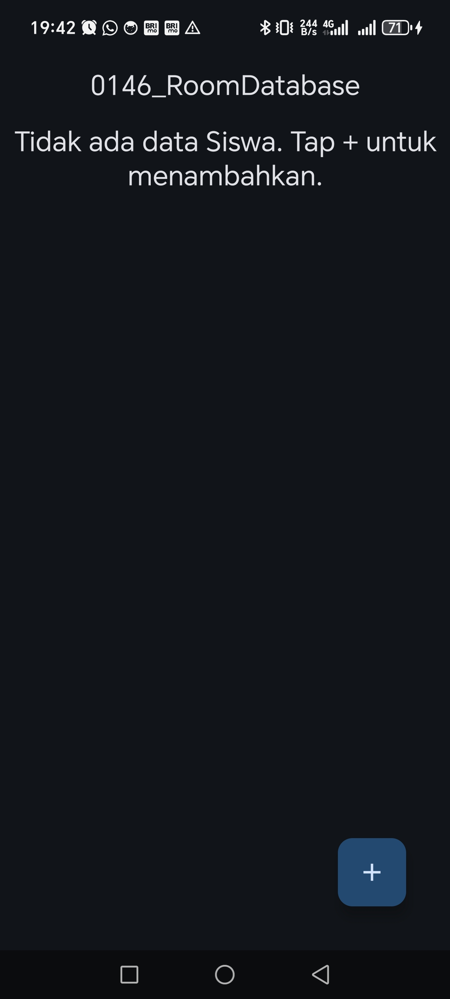
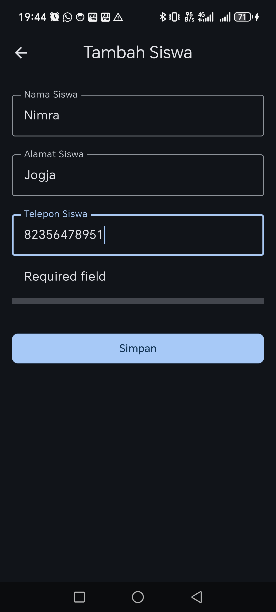
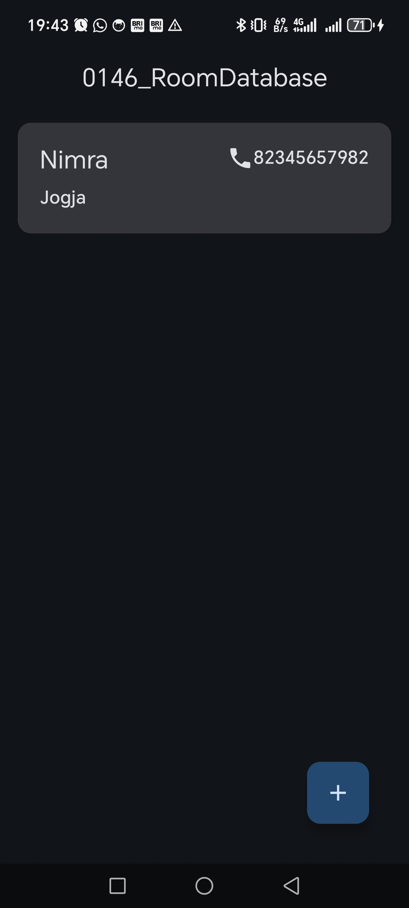
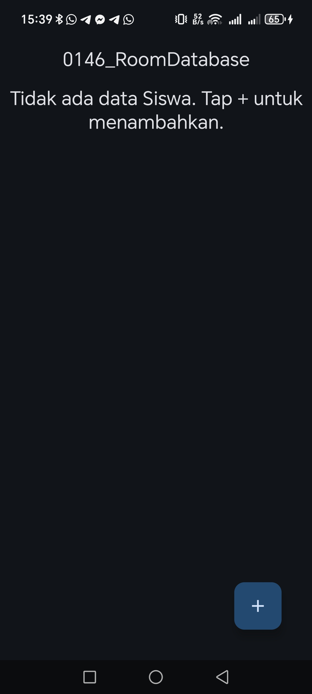
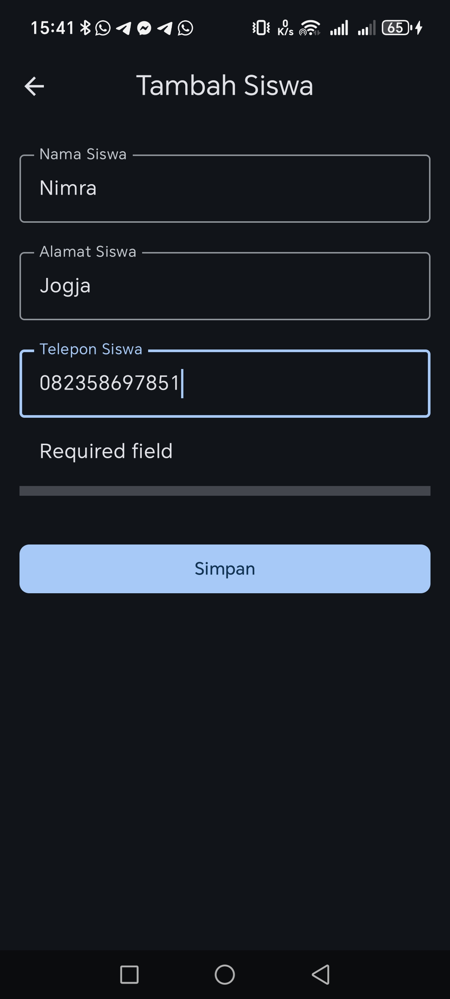
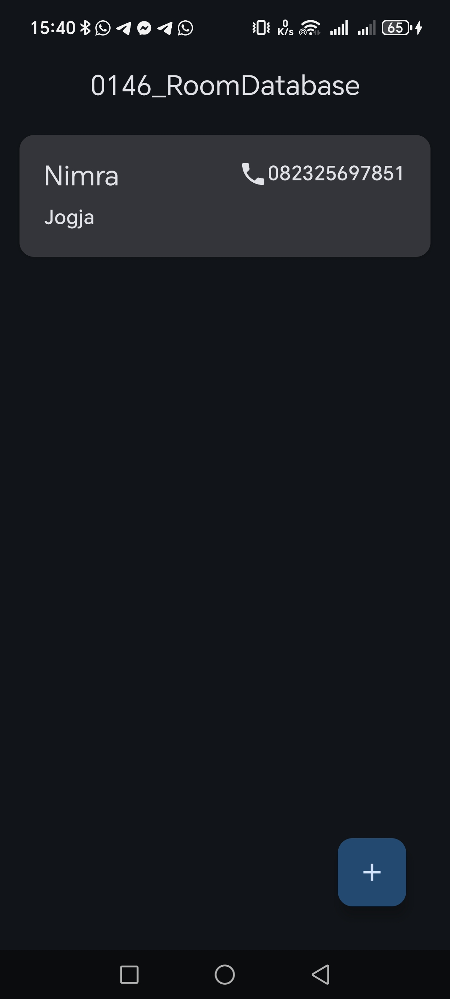

# 0146_RoomDatabase (Aplikasi Data Siswa)

This is a sample Android application built to demonstrate the integration of the **Room Database** with **Jetpack Compose**. It implements a robust MVVM architecture, manual Dependency Injection, and modern Android development practices using Kotlin.

The application allows users to manage a list of students (Siswa), providing features to view the list and add new entries with real-time form validation.

## Features

* **Home Screen:** Displays a list of students fetched from the local Room database efficiently using `StateFlow`.
* **Entry Screen:** A dedicated form to add new students with input validation (Name, Address, Phone).
* **Local Persistence:** Data is stored locally and securely on the device using Room.
* **Modern UI:** Fully built with Jetpack Compose and Material Design 3 guidelines.

## Screenshots Session 9

### Home Screen
<p align="center">
  
  &nbsp;&nbsp;&nbsp;&nbsp;
  
</p>
<br>

### Entry Form Screen
<p align="center">
  
</p>
<br>

## Tech Stack & Libraries

* **UI:** Jetpack Compose, Material 3
* **Architecture:** MVVM (Model-View-ViewModel), Repository Pattern
* **Database:** Room Database (SQLite object mapping library)
* **Asynchronous Programming:** Kotlin Coroutines & Flow (StateFlow)
* **Navigation:** Navigation Compose
* **Dependency Injection:** Manual DI (AppContainer / `AplikasiSiswa`)

## Project Structure

* `room/`: Contains the Entity (`Siswa`), DAO (`SiswaDao`), and Database configuration (`DatabaseSiswa`).
* `repositori/`: Contains the repository interface and implementation for data access, plus the manual DI container (`ContainerApp`).
* `viewmodel/`: Contains ViewModels (`HomeViewModel`, `EntryViewModel`) mapping data flows to the UI, and a ViewModel Provider Factory.
* `view/`: Contains the declarative Compose UI screens (`HomeScreen`, `EntrySiswaScreen`).
* `uicontroller/`: Contains Navigation configurations, routing definitions, and standard TopAppBars.

## Getting Started

1. Clone this repository:
   ```bash
   git clone https://github.com/NimmraTariq/0146_RoomDatabase.git
   ```
2. Open the project in Android Studio.
3. Sync Gradle and build the project.
4. Run on an Android emulator or a physical device.

## Screenshots Session 10






